# RepoPilot

> **Default documentation language: Simplified Chinese**
> [简体中文 / Simplified Chinese](README.md) | [English (current)](README.en.md)

RepoPilot is an adaptive multi-agent system for debugging and repairing Python repositories. It accepts a bug description, an optional stack trace, a Git repository, and controlled test commands, then performs code retrieval, root-cause analysis, Unified Diff generation, isolated patch execution, real tests, execution-aware reflection, human approval, and traceable reporting.

The project also evaluates how Planning, Code RAG, Memory, Reflection, and Sandboxing contribute to a reliable software-repair workflow. Every LLM output is schema-validated, and every test result comes from a deterministic Test Runner. A model cannot declare its own patch successful.

## Contents

- [Capabilities](#capabilities)
- [System Architecture](#system-architecture)
- [Task Lifecycle](#task-lifecycle)
- [End-to-End Repair Flow](#end-to-end-repair-flow)
- [Adaptive Planning and Reflection](#adaptive-planning-and-reflection)
- [Security Boundaries](#security-boundaries)
- [Agent Responsibilities](#agent-responsibilities)
- [Technology Stack](#technology-stack)
- [Quick Start](#quick-start)
- [Configuration](#configuration)
- [CLI](#cli)
- [API and Frontend](#api-and-frontend)
- [Benchmark and Experiments](#benchmark-and-experiments)
- [Real Experiment Summary](#real-experiment-summary)
- [Delivery Status](#delivery-status)
- [Known Issues and Limitations](#known-issues-and-limitations)
- [Documentation](#documentation)

## Capabilities

| Capability | Implementation | Trust boundary |
|---|---|---|
| LangGraph Runtime | Stateful nodes, conditional routing, checkpoints | Invalid structured output cannot enter downstream nodes |
| Multi-Agent workflow | Planner, Research, Diagnosis, Coding, Review, Reflection | Agents emit validated structured results only |
| Code RAG | AST chunks, path/symbol/stack localization, BM25, optional vectors | Evidence preserves file, line range, and commit |
| Tool Gateway | Registry, schemas, permissions, timeouts, output limits | Agents do not access the host directly |
| Patch workflow | Unified Diff, Patch Validator, isolated Worktree | Coding never writes repository files directly |
| Test Runner | Controlled pytest commands, baseline/post-patch tests | Real exit codes and outputs are authoritative |
| Memory | Checkpointer state and SQLite experiences | Memory assists planning but never replaces current evidence |
| Reflection | Classifies failures from TestReport, Diff, and ToolResult | Bounded retries, rollback, and traceability |
| Evaluation | Mini-Benchmark, raw records, metrics, Bootstrap intervals | Missing data remains `unknown`; results are not fabricated |
| Service surfaces | CLI, FastAPI, lightweight Web Dashboard | No arbitrary shell, push, merge, or deployment endpoint |

## System Architecture

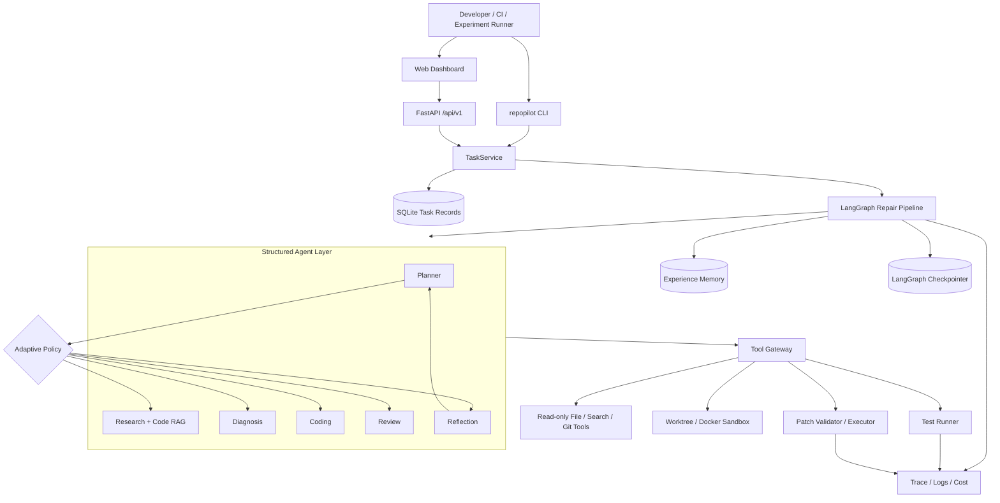

Key design principles:

1. **Control plane and execution plane are separated.** LLM Agents emit structured decisions and Unified Diffs, but cannot execute arbitrary commands or write host files.
2. **Execution facts take precedence.** Review and Reflection consume real TestReports, ToolResults, Git Diffs, and Traces.
3. **Everything is traceable.** Evidence, Tool Calls, tests, patches, and recovery actions are preserved in state and reports.
4. **Optional capabilities degrade safely.** Without embeddings, Docker, or external databases, BM25, local Worktrees, and Fake LLM tests remain available.

See [docs/architecture.md](docs/architecture.md) for detailed design.

## Task Lifecycle

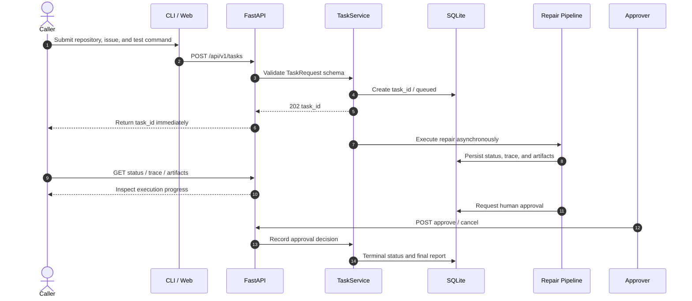

Long-running work executes in a thread pool. The HTTP request does not wait for repair completion. `task_id` links status, Trace, Diff, TestReports, and approval records.

## End-to-End Repair Flow

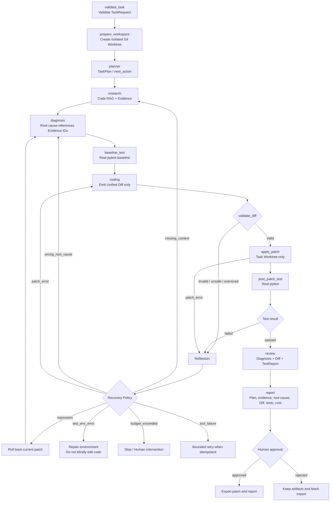

Execution guarantees:

- Baseline and post-patch tests run independently and record exit code, stdout, stderr, and duration.
- Test commands come from a controlled allowlist and execute as argument arrays.
- Patches apply only to the task Worktree; the source repository is not modified.
- Every failed node records `failure_node` and `failure_reason`; success is never fabricated.

## Adaptive Planning and Reflection

### Planning decisions

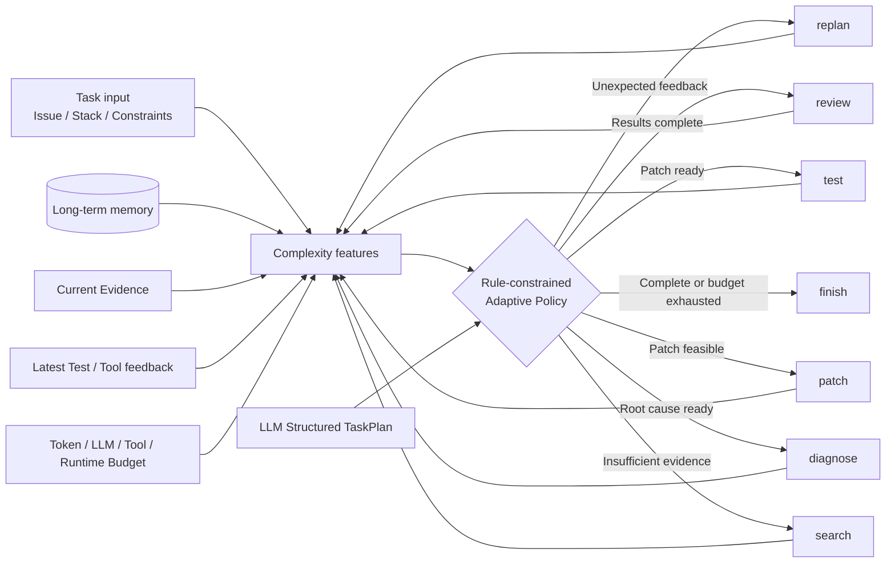

The bounded action space is:

```text
search, inspect, diagnose, patch, test, review, replan, finish
```

`TaskPlan` validation enforces unique step IDs, valid dependencies, an acyclic DAG, and legal actions. `finish`, budget exhaustion, and permission rejection are hard stops. The Static Workflow remains as the experimental baseline.

### Reflection recovery policy

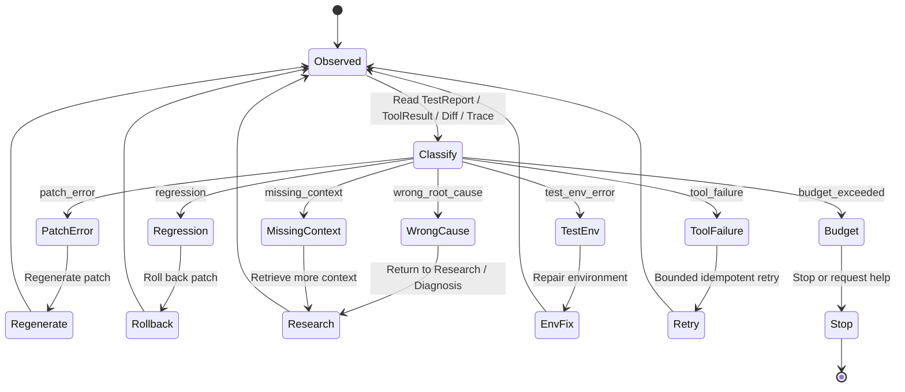

Patch Retry, Replan, and Tool Retry have separate limits. Reflection emits a structured `ReflectionResult` and converts it into `PlannerFeedback`, rather than an unexecutable natural-language note.

## Security Boundaries

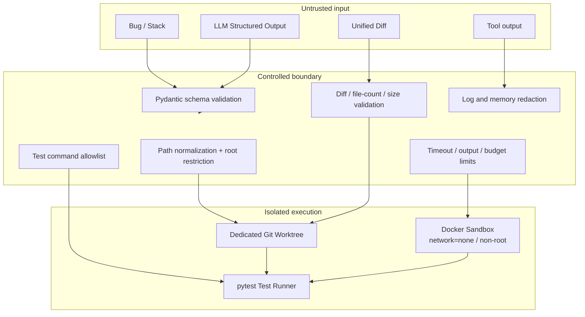

Explicitly prohibited:

- Arbitrary host shell execution by Agents.
- `../` traversal, symlink escape, and out-of-repository reads.
- Direct source repository writes by the Coding Agent.
- Arbitrary command execution APIs.
- Automatic push, merge, or deployment.
- API keys, tokens, passwords, Gold Patches, or hidden test answers in logs, Memory, Trace, or Git.

## Agent Responsibilities

| Module | Input | Output | Constraint |
|---|---|---|---|
| Planner | Task, Evidence, Memory, feedback, budgets | `TaskPlan`, `next_action` | Acyclic plan, bounded actions and budgets |
| Research | Issue, stack, Code RAG hits | `ResearchResult`, `Evidence` | File, line, symbol, and commit provenance |
| Diagnosis | Evidence, baseline test, issue | `Diagnosis` | Must cite valid Evidence IDs |
| Coding | Diagnosis, relevant code, constraints | `PatchResult` | Unified Diff only |
| Test Runner | Controlled command, task Worktree | `TestReport` | Deterministic Tool, not an LLM |
| Review | Diff, Diagnosis, real tests | `ReviewResult` | Cannot override real test outcomes |
| Reflection | TestReport, ToolResult, Diff, Trace | `ReflectionResult` | Bounded, typed recovery actions |

## Technology Stack

- Python 3.11+
- Pydantic v2
- LangGraph
- FastAPI / Uvicorn
- SQLite
- pathspec
- pytest
- uv
- Docker CLI / Sandbox (implemented, real daemon not verified)
- Optional OpenAI-compatible LLM and Embedding adapters

## Quick Start

### Requirements

- Python 3.11 or newer
- `uv`
- Git
- Optional: Docker daemon, OpenAI-compatible model API, Embedding API

### Install

```bash
git clone git@github.com:CaoJiahao2/RepoPilot.git
cd RepoPilot
uv sync --extra dev
```

### Configure local environment

```bash
cp .env.example .env
```

Put model and database credentials only in local `.env`. It is excluded by `.gitignore`; never commit real credentials.

Load the current environment:

```bash
set -a
source .env
set +a
```

### Run tests

```bash
uv run --extra dev pytest -q
```

### Run the Fake LLM demo

No real API key is required:

```bash
uv run repopilot demo
```

The demo performs real Code RAG, Git Worktree, Patch Validator/Executor, and pytest Test Runner work. Its report sets `execution_mode="fake_llm"` so it cannot be mistaken for a real-model experiment.

### Start API and frontend

```bash
uv run uvicorn repopilot.api:create_app --factory --host 127.0.0.1 --port 8765
```

Open `http://127.0.0.1:8765/`.

## Configuration

Configuration precedence:

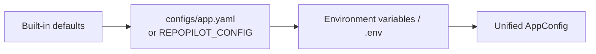

Primary settings:

| Category | Variables | Default behavior |
|---|---|---|
| LLM | `LLM_ENABLED`, `LLM_PROVIDER`, `LLM_MODEL`, `LLM_BASE_URL`, `LLM_API_KEY` | Real LLM disabled unless configured |
| Embedding | `EMBEDDING_*` | Exact retrieval and BM25 remain available |
| Database | `DATABASE_BACKEND`, `DATABASE_URL` | SQLite |
| Checkpoint | `CHECKPOINTER_BACKEND` | SQLite |
| Sandbox | `SANDBOX_BACKEND`, `SANDBOX_NETWORK_DISABLED`, `SANDBOX_TIMEOUT_SECONDS` | Local Worktree |
| Budget | `MAX_LLM_CALLS`, `MAX_TOTAL_TOKENS`, `MAX_TOOL_CALLS`, `MAX_RUNTIME_SECONDS` | Hard stop at limits |
| Retry | `MAX_PATCH_RETRIES`, `MAX_REPLANS`, `MAX_TOOL_RETRIES` | Separate bounded counters |
| Logging | `LOG_LEVEL`, `LOG_FORMAT` | Redacted JSON logs |

See [`.env.example`](.env.example) and [`configs/app.yaml`](configs/app.yaml).

## CLI

```bash
# Submit a repair task and receive a task_id
uv run repopilot run \
  --repo ./target-repo \
  --issue "parse_config raises TypeError for an empty dictionary" \
  --test-command "python -m pytest -q"

# Inspect status, trace, and artifacts
uv run repopilot status <task-id>
uv run repopilot trace <task-id>
uv run repopilot artifacts <task-id>

# Record a human approval decision
uv run repopilot approve <task-id> --approved --actor alice --reason "tests passed"

# Cancel a task
uv run repopilot cancel <task-id> --reason "operator cancelled"

# Run benchmark infrastructure
uv run repopilot benchmark run \
  --dataset benchmarks/tasks \
  --output benchmark-results \
  --group full
```

`--test-command` must parse into an argument vector. It is never concatenated into a Shell command.

## API and Frontend

### API

| Method | Path | Purpose |
|---|---|---|
| `GET` | `/api/v1/tasks` | List tasks |
| `POST` | `/api/v1/tasks` | Submit an asynchronous task |
| `GET` | `/api/v1/tasks/{task_id}` | Read task status |
| `GET` | `/api/v1/tasks/{task_id}/trace` | Read execution trace |
| `GET` | `/api/v1/tasks/{task_id}/artifacts` | Read Diff and TestReports |
| `POST` | `/api/v1/tasks/{task_id}/approve` | Approve or reject the final patch |
| `POST` | `/api/v1/tasks/{task_id}/cancel` | Cancel a task |

Requests and responses use Pydantic models with unified JSON errors. There is no arbitrary command execution, push, merge, or deployment endpoint.

### Frontend data flow

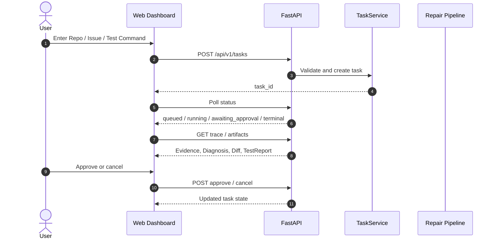

The dependency-light frontend in `frontend/` shows real task queues, Traces, Evidence, Diagnosis, Diffs, TestReports, approval actions, and saved experiment charts. It does not use static fake data to imitate execution.

## Benchmark and Experiments

### Data isolation

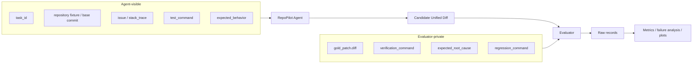

`benchmarks/tasks` currently contains 10 reproducible Python bug fixtures. Each task has a clean Base Commit, public Agent input, and private evaluator data. Gold Patches and hidden verification commands never enter Agent state.

### Run the benchmark

```bash
uv run python -m repopilot.evaluation.cli \
  --dataset benchmarks/tasks \
  --output benchmark-results \
  --group full \
  --repeats 3
```

Outputs include:

```text
raw_results.jsonl
raw_results.csv
summary.json
summary.csv
runs/<task>/<group>-<run>/record.json
runs/<task>/<group>-<run>/failure.log
runs/<task>/<group>-<run>/patch.diff
```

Metrics include Resolution Rate, Patch Pass Rate, Regression Rate, Root Cause Accuracy, Tool Success Rate, Replanning Rate, Reflection Recovery Rate, Memory Retrieval Hit Rate, P50/P95 latency, Tokens, LLM Calls, and available cost. Missing price or token data remains `unknown/null`.

### Experiment groups and ablations

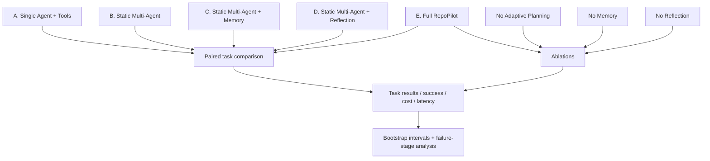

Groups A-E are compared with Full vs No Adaptive Planning, No Memory, and No Reflection. See [docs/experiments.md](docs/experiments.md).

## Real Experiment Summary

On 2026-11-14, the Full Pipeline used `deepseek-v4-1-flash-261017` on 10 Mini-Benchmark tasks with 3 runs per task, for 30 real runs.

| Metric | Measured result |
|---|---:|
| Resolution Rate | 28 / 30 = **93.33%** |
| Patch Pass Rate | 28 / 30 = **93.33%** |
| Regression Rate | **0%** |
| Total LLM Calls | 117 |
| Input Tokens | 82,825 |
| Output Tokens | 76,446 |
| Mean Latency | 30.672s |
| P50 Latency | 28.806s |
| P95 Latency | 40.094s |
| Resolution Bootstrap 95% CI | 83.33% - 100.00% |

Failure distribution:

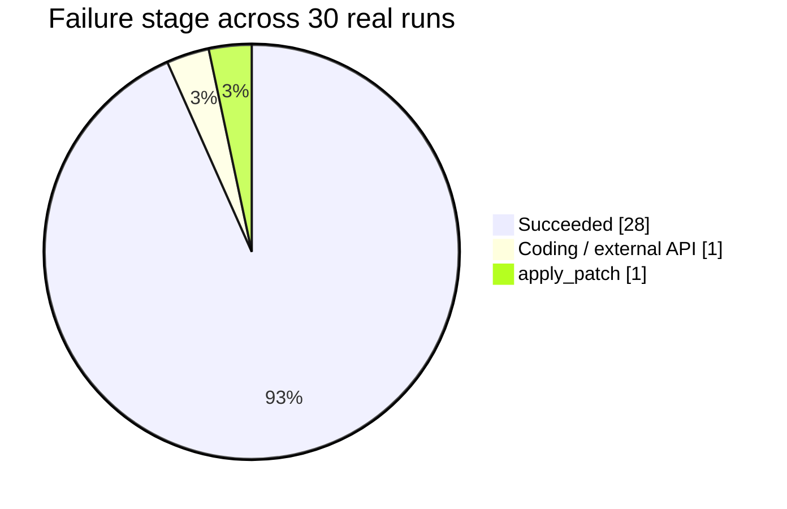

These measurements validate **Full Pipeline stability**. They do not establish causal gains from Multi-Agent, Memory, Reflection, or Adaptive Planning. The A-E comparisons and ablations remain unverified, so no statistically significant improvement is claimed.

Raw data, plots, and reproduction commands are in [docs/experiment_report.md](docs/experiment_report.md) and [`experiment-results-real-full-v2/`](experiment-results-real-full-v2/).

## Delivery Status

| Status | Items |
|---|---|
| Implemented and tested | Schemas, config, LangGraph, Code RAG, Tool Gateway, Worktree/Patch/Test, Memory, Planning, Reflection, CLI, API, frontend, Benchmark Runner |
| Implemented but not fully verified | Docker Sandbox, Embedding retrieval, persistent Checkpointer, real A-E experiments, automated Root Cause Accuracy |
| Not implemented | MCP, RL Planner, automatic push/merge/deploy, distributed scheduling |
| Environment-limited / unverified | Docker daemon, PostgreSQL/pgvector, model price table, broad external generalization |

See [docs/final_acceptance.md](docs/final_acceptance.md) for the acceptance matrix.

## Known Issues and Limitations

1. Thirty real Full Pipeline runs do not replace A-E comparisons or ablations.
2. The benchmark has 10 tasks and has not reached the 20-30 task target.
3. `task-001` and `task-003` each failed once; patch context and external API stability remain optimization targets.
4. Docker daemon is unavailable, so container networking and resource restrictions are not verified.
5. Root Cause Accuracy is not yet automatically checked by the private evaluator.
6. No pricing table is configured, so monetary cost remains `unknown`.
7. Production interfaces expose no arbitrary shell, automatic push, merge, or deployment.

## Documentation

The detailed project documents are currently written in Chinese:

- [Chinese README](README.md)
- [Architecture](docs/architecture.md)
- [Benchmark and evaluator](docs/benchmark.md)
- [Experiment design](docs/experiments.md)
- [Real Full Pipeline experiment report](docs/experiment_report.md)
- [Architecture decisions](docs/decisions.md)
- [Final acceptance](docs/final_acceptance.md)
- [Demo script](docs/demo_script.md)
- [Resume project description](docs/resume_project.md)
- [Interview questions](docs/interview_questions.md)

## License

No open-source license is currently declared. All rights are reserved by default until an explicit license is added; confirm authorization before external reuse.
