# RepoPilot

> **默认文档语言：简体中文**
> [简体中文（当前）](README.md) | [English](README.en.md)

RepoPilot 是一个面向 Python 软件仓库的自适应多 Agent 故障诊断与修复系统。它接收 Bug 描述、异常堆栈、Git 仓库和受控测试命令，完成代码检索、根因分析、Unified Diff 生成、隔离补丁执行、真实测试、失败反思、人工审批和可追溯报告。

项目同时用于验证 Planning、Code RAG、Memory、Reflection 和 Sandbox 在软件修复闭环中的工程价值。所有 LLM 输出都经过结构化校验，所有测试结果都来自确定性 Test Runner，不能由模型自行声明通过。

## 目录

- [核心能力](#核心能力)
- [系统架构](#系统架构)
- [任务生命周期](#任务生命周期)
- [端到端修复流程](#端到端修复流程)
- [Adaptive Planning 与 Reflection](#adaptive-planning-与-reflection)
- [安全边界](#安全边界)
- [Agent 职责](#agent-职责)
- [技术栈](#技术栈)
- [快速开始](#快速开始)
- [配置](#配置)
- [CLI](#cli)
- [API 与前端](#api-与前端)
- [Benchmark 与实验](#benchmark-与实验)
- [真实实验摘要](#真实实验摘要)
- [交付状态](#交付状态)
- [已知问题与限制](#已知问题与限制)
- [文档](#文档)

## 核心能力

| 能力 | 实现方式 | 可信边界 |
|---|---|---|
| LangGraph Runtime | 有状态节点、条件路由、Checkpoint | 非法状态不能进入下游 |
| 多 Agent | Planner、Research、Diagnosis、Coding、Review、Reflection | Agent 只能输出结构化结果 |
| Code RAG | AST Chunk、路径/符号/堆栈定位、BM25、可选向量融合 | Evidence 保留文件、行号和 Commit |
| Tool Gateway | Registry、Schema、权限、超时、输出限制 | Agent 不直接访问宿主机 |
| Patch 闭环 | Unified Diff、Patch Validator、独立 Worktree | Coding 不直接写文件 |
| Test Runner | 受控 pytest 命令、Baseline/Post-patch Test | 真实退出码和测试输出优先 |
| Memory | Checkpointer 短期状态、SQLite 长期经验 | Memory 只辅助规划，不覆盖当前证据 |
| Reflection | 基于 TestReport、Diff、ToolResult 分类失败 | 有限重试、可回滚、可追踪 |
| 评测 | Mini-Benchmark、原始记录、汇总指标、Bootstrap | 缺失数据标记 unknown，不伪造结果 |
| 服务化 | CLI、FastAPI、轻量 Web Dashboard | 无任意 Shell、push、merge、部署接口 |

## 系统架构

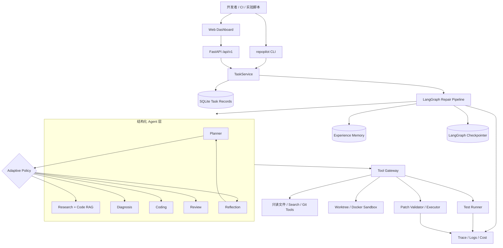

关键设计：

1. **控制面与执行面分离**：LLM Agent 只能生成结构化决策和 Unified Diff，不能直接执行任意命令或写宿主机文件。
2. **事实优先**：Review 和 Reflection 必须读取真实 TestReport、ToolResult、Git Diff 和 Trace。
3. **可追溯**：每个 Evidence、Tool Call、测试、补丁和恢复动作都进入结构化状态与报告。
4. **可降级**：Embedding、Docker、外部数据库不可用时，BM25、本地 Worktree 和 Fake LLM 测试路径仍可运行。

详细设计见 [docs/architecture.md](docs/architecture.md)。

## 任务生命周期

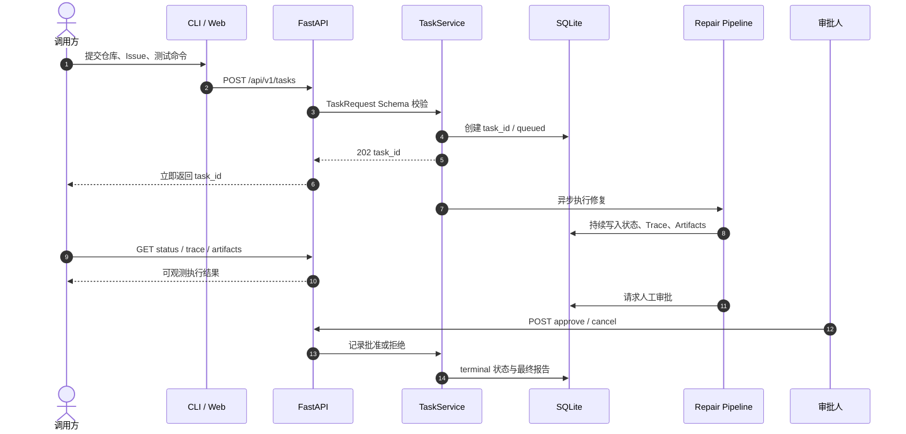

长任务由线程池异步执行，HTTP 请求不会阻塞。`task_id` 是状态、Trace、Diff、测试报告和审批记录的统一关联键。

## 端到端修复流程

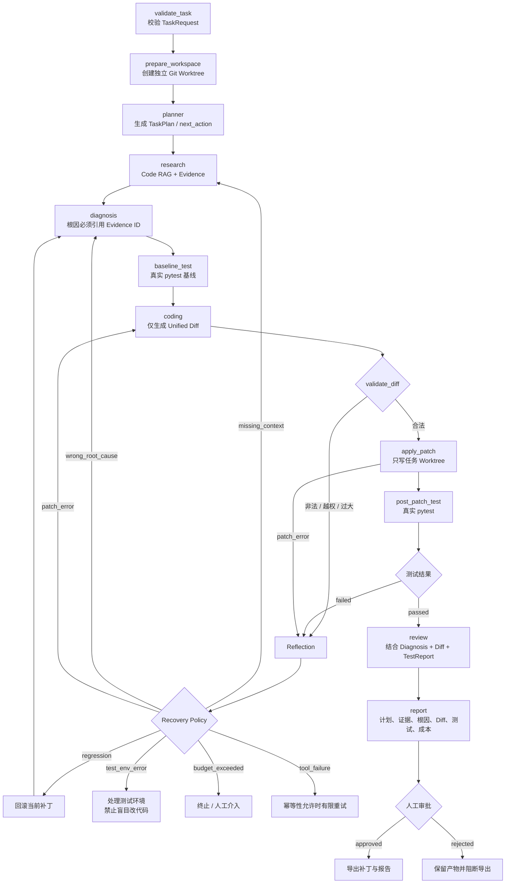

执行保证：

- Baseline Test 与 Post-patch Test 独立运行，保存退出码、stdout、stderr 和耗时。
- 测试命令来自受控 allowlist，并以参数数组执行。
- Patch 只应用于任务 Worktree，原始仓库保持不变。
- 任一节点失败都会记录 `failure_node` 和 `failure_reason`，不会伪造成功。

## Adaptive Planning 与 Reflection

### 规划决策

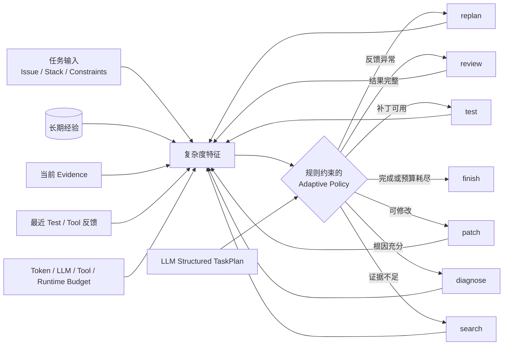

有限 Action 空间为：

```text
search, inspect, diagnose, patch, test, review, replan, finish
```

`TaskPlan` 必须通过 step ID 唯一性、依赖存在性、DAG 无环和动作合法性校验。`finish`、预算耗尽和权限拒绝是硬停止条件。Static Workflow 保留为实验基线。

### Reflection 恢复策略

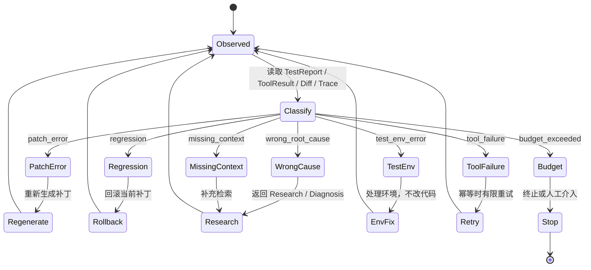

Patch Retry、Replan 和 Tool Retry 分别计数。Reflection 输出结构化 `ReflectionResult` 并转换为 `PlannerFeedback`，不是不可执行的自然语言备注。

## 安全边界

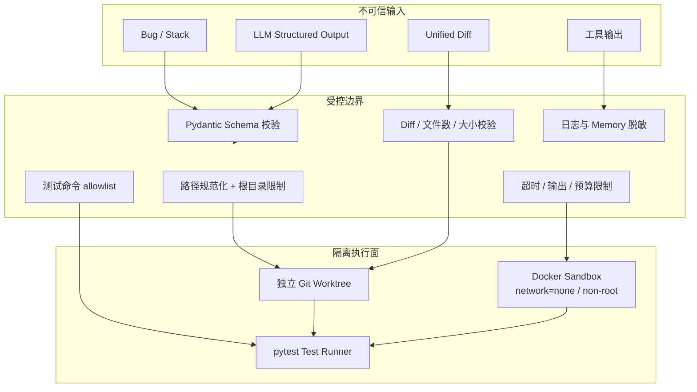

明确禁止：

- Agent 执行宿主机任意 Shell 命令。
- `../` 路径穿越、符号链接逃逸和仓库外读取。
- Coding Agent 直接修改原始仓库。
- API 暴露任意命令执行接口。
- 自动 push、merge 或部署。
- 在日志、Memory、Trace 或 Git 中保存 API Key、Token、密码、Gold Patch 或隐藏测试答案。

## Agent 职责

| 模块 | 输入 | 输出 | 关键约束 |
|---|---|---|---|
| Planner | Task、Evidence、Memory、反馈、预算 | `TaskPlan`、`next_action` | DAG 无环、动作和预算受限 |
| Research | Issue、Stack、Code RAG Hits | `ResearchResult` / `Evidence` | 文件、行号、符号、Commit 可追溯 |
| Diagnosis | Evidence、Baseline Test、Issue | `Diagnosis` | 必须引用有效 Evidence ID |
| Coding | Diagnosis、相关代码、约束 | `PatchResult` | 只能输出 Unified Diff |
| Test Runner | 受控命令、任务 Worktree | `TestReport` | 确定性 Tool，不是 LLM Agent |
| Review | Diff、Diagnosis、真实测试 | `ReviewResult` | 不接受模型自行声称通过 |
| Reflection | TestReport、ToolResult、Diff、Trace | `ReflectionResult` | 分类失败并给出有限恢复动作 |

## 技术栈

- Python 3.11+
- Pydantic v2
- LangGraph
- FastAPI / Uvicorn
- SQLite
- pathspec
- pytest
- uv
- Docker CLI / Sandbox（代码已实现，真实 Daemon 当前未验证）
- 可选 OpenAI-compatible LLM 与 Embedding Adapter

## 快速开始

### 环境要求

- Python 3.11 或更高版本
- `uv`
- Git
- 可选：Docker Daemon、OpenAI-compatible 模型 API、Embedding API

### 安装

```bash
git clone git@github.com:CaoJiahao2/RepoPilot.git
cd RepoPilot
uv sync --extra dev
```

### 配置本地环境

```bash
cp .env.example .env
```

只在本地 `.env` 中填写模型和数据库配置。`.env` 已被 `.gitignore` 排除，禁止提交真实凭证。

当前环境变量加载方式：

```bash
set -a
source .env
set +a
```

### 运行测试

```bash
uv run --extra dev pytest -q
```

### 运行 Fake LLM Demo

不需要真实 API Key：

```bash
uv run repopilot demo
```

Demo 会真实执行 Code RAG、Git Worktree、Patch Validator/Executor 和 pytest Test Runner；报告中的 `execution_mode="fake_llm"` 明确标识其不是真实模型实验结果。

### 启动 API 与前端

```bash
uv run uvicorn repopilot.api:create_app --factory --host 127.0.0.1 --port 8765
```

打开 `http://127.0.0.1:8765/`。

## 配置

配置优先级：

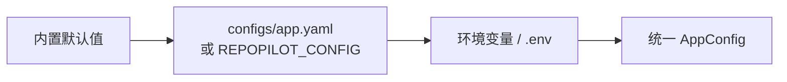

主要配置：

| 类别 | 变量 | 默认行为 |
|---|---|---|
| LLM | `LLM_ENABLED`, `LLM_PROVIDER`, `LLM_MODEL`, `LLM_BASE_URL`, `LLM_API_KEY` | 未配置时禁用真实 LLM |
| Embedding | `EMBEDDING_*` | 未配置时仅使用精确检索和 BM25 |
| Database | `DATABASE_BACKEND`, `DATABASE_URL` | 默认 SQLite |
| Checkpoint | `CHECKPOINTER_BACKEND` | 默认 SQLite |
| Sandbox | `SANDBOX_BACKEND`, `SANDBOX_NETWORK_DISABLED`, `SANDBOX_TIMEOUT_SECONDS` | 默认本地 Worktree |
| Budget | `MAX_LLM_CALLS`, `MAX_TOTAL_TOKENS`, `MAX_TOOL_CALLS`, `MAX_RUNTIME_SECONDS` | 超限硬停止 |
| Retry | `MAX_PATCH_RETRIES`, `MAX_REPLANS`, `MAX_TOOL_RETRIES` | 分开限额，禁止无限重试 |
| Logging | `LOG_LEVEL`, `LOG_FORMAT` | JSON 日志并脱敏 |

完整安全示例见 [`.env.example`](.env.example) 和 [`configs/app.yaml`](configs/app.yaml)。

## CLI

```bash
# 提交修复任务并返回 task_id
uv run repopilot run \
  --repo ./target-repo \
  --issue "空字典输入导致 parse_config 抛出 TypeError" \
  --test-command "python -m pytest -q"

# 查看状态、轨迹和产物
uv run repopilot status <task-id>
uv run repopilot trace <task-id>
uv run repopilot artifacts <task-id>

# 记录人工审批
uv run repopilot approve <task-id> --approved --actor alice --reason "tests passed"

# 取消任务
uv run repopilot cancel <task-id> --reason "operator cancelled"

# 运行 Benchmark
uv run repopilot benchmark run \
  --dataset benchmarks/tasks \
  --output benchmark-results \
  --group full
```

`--test-command` 必须是可解析为参数数组的命令，不通过 Shell 拼接执行。

## API 与前端

### API

| 方法 | 路径 | 用途 |
|---|---|---|
| `GET` | `/api/v1/tasks` | 查询任务列表 |
| `POST` | `/api/v1/tasks` | 异步提交任务 |
| `GET` | `/api/v1/tasks/{task_id}` | 查询任务状态 |
| `GET` | `/api/v1/tasks/{task_id}/trace` | 查询执行轨迹 |
| `GET` | `/api/v1/tasks/{task_id}/artifacts` | 查询 Diff 和测试报告 |
| `POST` | `/api/v1/tasks/{task_id}/approve` | 批准或拒绝最终补丁 |
| `POST` | `/api/v1/tasks/{task_id}/cancel` | 取消任务 |

请求和响应均由 Pydantic 校验，错误结构统一。API 不提供任意命令执行、push、merge 或部署能力。

### 前端数据流

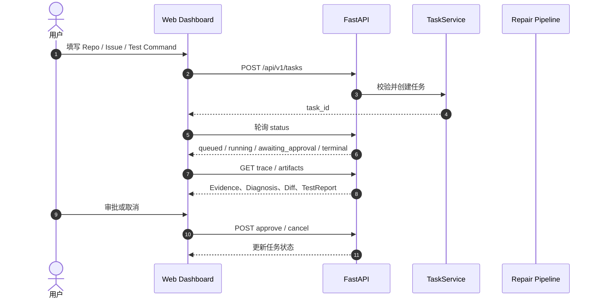

前端位于 `frontend/`，展示真实任务队列、Trace、Evidence、Diagnosis、Diff、测试报告、审批操作和实验图表，不使用静态假数据冒充执行结果。

## Benchmark 与实验

### 数据隔离

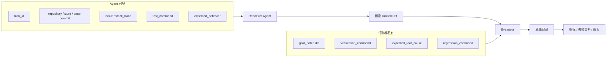

当前 `benchmarks/tasks` 包含 10 个可复现 Python Bug Fixture。每个任务具有干净 Base Commit、公开 Agent 输入和私有评测数据。Gold Patch 和隐藏验证命令不会进入 Agent 状态。

### 运行 Benchmark

```bash
uv run python -m repopilot.evaluation.cli \
  --dataset benchmarks/tasks \
  --output benchmark-results \
  --group full \
  --repeats 3
```

输出包括：

```text
raw_results.jsonl
raw_results.csv
summary.json
summary.csv
runs/<task>/<group>-<run>/record.json
runs/<task>/<group>-<run>/failure.log
runs/<task>/<group>-<run>/patch.diff
```

指标包括 Resolution Rate、Patch Pass Rate、Regression Rate、Root Cause Accuracy、Tool Success Rate、Replanning Rate、Reflection Recovery Rate、Memory Retrieval Hit Rate、P50/P95 延迟、Token、LLM Calls 和可用成本。缺失价格或 Token 数据保持 `unknown/null`。

### 实验组与消融

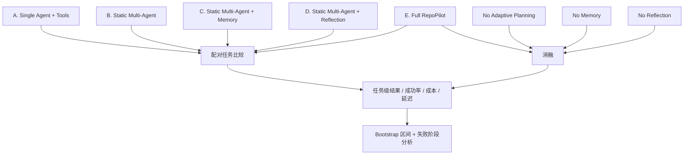

实验组包括 A-E，以及 Full vs No Adaptive Planning、No Memory、No Reflection。完整方法见 [docs/experiments.md](docs/experiments.md)。

## 真实实验摘要

2026-11-14 使用 `deepseek-v4-1-flash-261017` 对 10 个 Mini-Benchmark 任务执行 3 次 Full Pipeline，共 30 次真实运行。

| 指标 | 实测结果 |
|---|---:|
| Resolution Rate | 28 / 30 = **93.33%** |
| Patch Pass Rate | 28 / 30 = **93.33%** |
| Regression Rate | **0%** |
| Total LLM Calls | 117 |
| Input Tokens | 82,825 |
| Output Tokens | 76,446 |
| Mean Latency | 30.672s |
| P50 Latency | 28.806s |
| P95 Latency | 40.094s |
| Resolution Bootstrap 95% CI | 83.33% - 100.00% |

失败分布：

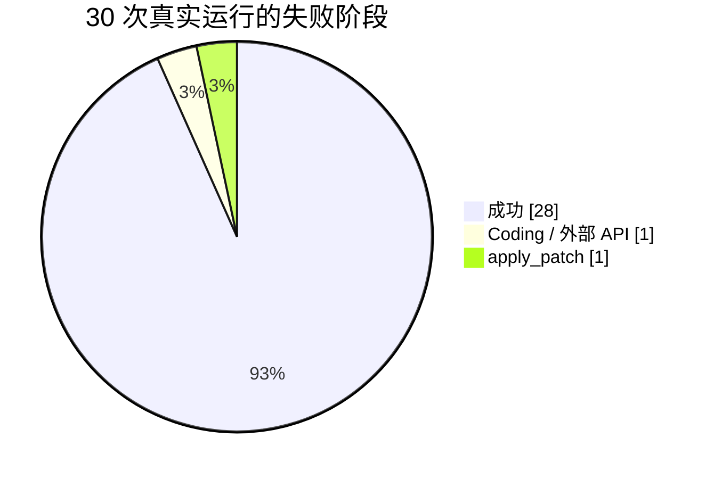

这些结果验证的是 **Full Pipeline 稳定性**，不是 Multi-Agent、Memory、Reflection 或 Adaptive Planning 的因果增益。A-E 对比和消融实验仍未完成，因此不能据此宣称这些机制带来统计显著提升。

原始数据、图表和复现命令见 [docs/experiment_report.md](docs/experiment_report.md) 与 [`experiment-results-real-full-v2/`](experiment-results-real-full-v2/)。

## 交付状态

| 分类 | 项目 |
|---|---|
| 已实现并通过测试 | Schema、Config、LangGraph、Code RAG、Tool Gateway、Worktree/Patch/Test、Memory、Planning、Reflection、CLI、API、前端、Benchmark Runner |
| 已实现但未充分验证 | Docker Sandbox、Embedding 检索、持久化 Checkpointer、真实 A-E 实验、Root Cause Accuracy 自动核验 |
| 未实现 | MCP、RL Planner、自动 push/merge/deploy、分布式调度 |
| 环境限制未验证 | Docker Daemon、PostgreSQL/pgvector、模型价格表、完整外部泛化效果 |

逐项证据见 [docs/final_acceptance.md](docs/final_acceptance.md)。

## 已知问题与限制

1. 30 次真实 Full Pipeline 运行不能替代 A-E 对比和消融实验。
2. 当前 Benchmark 只有 10 个任务，尚未扩展到 20-30 个。
3. `task-001`、`task-003` 各出现一次失败，Patch 上下文和外部 API 稳定性仍需优化。
4. Docker Daemon 当前不可用，容器网络禁用和资源限制未做真实验证。
5. Root Cause Accuracy 尚未由私有评测器自动核验。
6. 未配置价格表，因此货币成本保持 `unknown`。
7. 生产接口不提供任意 Shell、自动 push、merge 或部署。

## 文档

- [英文 README](README.en.md)
- [架构设计](docs/architecture.md)
- [Benchmark 与评测器](docs/benchmark.md)
- [实验设计](docs/experiments.md)
- [真实 Full Pipeline 实验报告](docs/experiment_report.md)
- [架构决策](docs/decisions.md)
- [最终验收](docs/final_acceptance.md)
- [Demo 脚本](docs/demo_script.md)
- [简历项目描述](docs/resume_project.md)
- [面试追问](docs/interview_questions.md)

## License

当前仓库未声明开源 License。在添加明确 License 前，默认保留所有权利；对外复用前请先确认授权。
